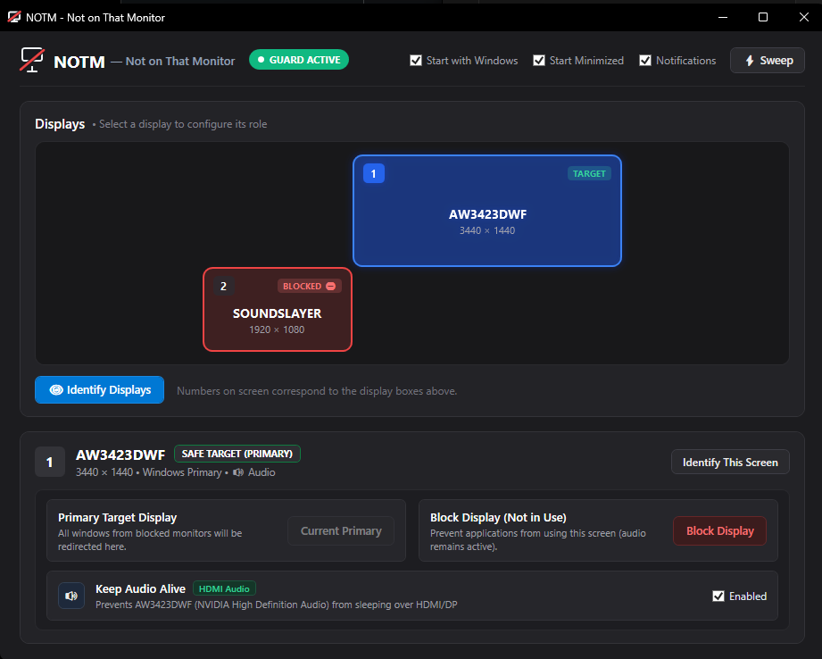

# BarControl

A Windows utility designed for seamless HDMI soundbar integration. BarControl solves the common headaches of using an HDMI soundbar or AV receiver with a PC: guarding phantom displays, preventing audio sleep, and providing **HDMI-CEC hardware control** via the **Pulse-Eight USB-CEC Adapter**.



---

## 1. What It Does and Why

### The Problems
1. **Phantom Displays & Window Trapping**:
   When connecting an HDMI soundbar (such as a Panasonic SoundSlayer) or AV receiver to a Windows PC, Windows detects the HDMI connection as a display monitor. Disabling it cuts audio completely; leaving it enabled causes windows and mouse cursors to get lost on a non-existent screen.
2. **Audio Sleep / Startup Clipping**:
   HDMI soundbars frequently sleep when idle, cutting off the first few seconds of notification sounds or audio playback.
3. **Dolby Atmos / Bitstream Volume Lockout**:
   When streaming Dolby Atmos, DTS, or direct bitstream audio, Windows volume controls are bypassed. Users are left unable to change volume with Windows volume keys or sliders.
4. **Power State Desync**:
   Soundbars often stay powered on indefinitely when the PC sleeps, or fail to wake automatically when audio playback begins.

### The BarControl Solution
- **Phantom Display Guard**: Prevents windows from getting trapped on the soundbar display, instantly redirecting them back to your primary monitor while preserving window dimensions.
- **Continuous Audio Keep-Alive**: Generates imperceptible sub-audible keep-alive signals to keep the HDMI audio pipeline primed.
- **Pulse-Eight HDMI-CEC Control**:
  - **Power Sync**: Automatically turns the soundbar ON/OFF (Standby) in sync with PC sleep/wake and display activity.
  - **CEC Volume Proxy & Bridge**: Detects the soundbar via CEC, interrogates supported volume range, and transparently proxies Windows volume changes to the soundbar over CEC during direct Atmos/DTS streaming.

---

## 2. How to Use It

### ⚡ Getting Started

#### Option A: Download Standalone Executable (Recommended)
1. Go to **[Releases](https://github.com/goldcd/BarControl/releases/latest)**.
2. Download **`BarControl.exe`**.
3. Run it from anywhere — no installation or external runtimes required.

#### Option B: One-Click Installer (Local)
1. Download or clone this repository.
2. Double-click **`install.cmd`** (no administrator rights needed).
   - Installs cleanly to `%LocalAppData%\Programs\BarControl`
   - Creates a Start Menu shortcut
   - Adds BarControl to Windows Settings > Installed Apps

#### Option C: Build from Source
```cmd
git clone https://github.com/goldcd/BarControl.git
cd BarControl
publish.cmd
```
*`publish.cmd` builds the standalone, self-contained single-file executable to `dist\BarControl.exe` (note: `dist/` is `.gitignore`d to prevent large binary bloat in the git repository).*

---

### How to Use BarControl
1. **Configure Displays**:
   - Open BarControl (it opens on start, or left-click its system tray icon by the clock).
   - The UI shows your displays arranged according to their Windows Display Settings positions.
   - Click **Identify Displays** to flash large labels onto all screens.
   - Select your soundbar / secondary display and click **Block Display (Not in Use)**.
   - Ensure your main monitor is marked as **Primary Target**.
2. **Audio Keep-Alive**:
   - For any display with an associated HDMI/DP audio endpoint (such as the SoundSlayer), the **Keep Audio Alive** card is automatically available and enabled.
3. **Tray Controls (by the Clock)**:
   - **Left-Click**: Instantly opens / restores the BarControl GUI.
   - **Right-Click**: Opens the quick menu (*Open BarControl*, *Guard: Active/Paused toggle*, *Identify Displays*, *Reset Target*, and *Exit*).

To uninstall completely, run `uninstall.cmd` or uninstall from **Windows Settings > Apps > Installed Apps**.


---

## 3. Technical Details

For anyone interested in the implementation details:

### Architecture & Stack
- **Target Runtime**: .NET 8 LTS (`net8.0-windows`), Win-x64 standalone single-file binary.
- **UI Framework**: WPF (Windows Presentation Foundation) styled to match Windows 11 Fluent dark mode.
- **Resource Footprint**: ~25 MB RAM, 0% CPU at idle.

### Win32 Relocation Engine
- **Event Hooks**: Uses native `SetWinEventHook` to listen out-of-context for:
  - `EVENT_OBJECT_LOCATIONCHANGE`: Catches keyboard-driven moves (such as `Win + Shift + Arrow`) immediately without polling.
  - `EVENT_SYSTEM_MOVESIZEEND`: Catches mouse drag-and-drop operations the moment a window is released.
  - `EVENT_OBJECT_SHOW`: Catches newly created windows launching directly onto a blocked screen.
  - `EVENT_SYSTEM_FOREGROUND`: Ensures newly focused windows are on allowed screens.
- **Fallback Sweep**: A lightweight background timer periodically checks all top-level windows to catch any unhooked background processes.
- **Hardware Plug/Unplug Detection**: Hooks `WM_DISPLAYCHANGE` window messages. When a soundbar powers on/off, wakes from sleep, or a cable is reconnected, BarControl automatically re-enumerates displays and updates its layout without needing a restart.
- **Display Friendly Names**: Reads monitor model names (e.g., `AW3423DWF`, `SOUNDSLAYER`) directly via WMI (`WmiMonitorID` EDID parsing) rather than generic `\\.\DISPLAY#` strings.
- **Display Protection Guard**: Uses `Win32.MonitorFromWindow` to prevent designating an off-limits or invisible screen as primary.
- **DWM Redraw Cleanliness**: Dispatches `Win32.RedrawWindow` with `RDW_FRAME | RDW_INVALIDATE | RDW_UPDATENOW` after repositioning to prevent DirectX / hardware composition tearing.

### Audio Keep-Alive (WASAPI Engine)
- **Problem Solved**: Digital soundbars (e.g. Panasonic SoundSlayer), AV receivers, and DACs often enter a power-saving sleep state when silent. When audio starts playing, the first 1-2 seconds get clipped or delayed while the HDMI audio clock re-syncs.
- **Per-Device Targeting**: Rather than keeping all audio devices awake or waking headphones when you don't want them, BarControl correlates connected HDMI/DisplayPort audio endpoints with their specific physical displays. If a monitor has an associated soundbar or audio output, a dedicated **Keep Audio Alive** option appears directly on that display card (default: ON). Displays without audio outputs keep this option cleanly hidden.
- **Power-State Aware**: When you turn off your soundbar, BarControl stops streaming to it and waits for it without ever keeping alive whatever other audio output you might be using (such as headphones or desktop speakers). When the soundbar is powered back on, BarControl resumes keeping it awake automatically.
- **Implementation**: Uses native Windows Audio Session API (`IAudioClient`) in shared mode targeted specifically to the endpoint to stream inaudible keep-alive samples (`Fluctuate` mode) with ~0% CPU. A minimal non-zero sample is emitted at 50Hz (every `sampleRate/50` frames), alternating polarity to maintain zero DC bias. The sample size is chosen from the endpoint's real hardware output format (`PKEY_AudioEngine_DeviceFormat`): `0x38000100` (1/32767) for 16-bit outputs, `0x34000001` (1/8388607) otherwise, so the pulse is not rounded away to digital silence.
- **Acknowledgements & Credit**: The audio keep-alive feature and `Fluctuate` stream implementation are directly inspired by and based on the work of **VEG** in [SoundKeeper](https://github.com/vrubleg/soundkeeper).

### Build & Utility Scripts
| Script | Description |
| :--- | :--- |
| `run.cmd` | Runs the app from source (`dotnet run`). |
| `build.cmd` | Builds the solution in Release mode (`dotnet build`). |
| `publish.cmd` | Builds the self-contained single-file executable to `dist\BarControl.exe`. |
| `install.cmd` | Builds and installs BarControl to user profile with Start Menu shortcut. |
| `uninstall.cmd` | Cleanly removes BarControl, shortcuts, and registry entries. |
| `installer.iss` | Inno Setup script for building a standard Windows setup wizard installer. |

### Repository Structure
```
BarControl/
├── Core/
│   ├── Audio/
│   │   ├── AudioKeepAliveService.cs  # WASAPI background keep-alive worker
│   │   └── Wasapi.cs                 # Native WASAPI COM interop signatures
│   ├── Native/
│   │   └── Win32.cs                  # Win32 P/Invoke APIs (SetWinEventHook, DWM, RedrawWindow)
│   ├── Display/
│   │   ├── DisplayInfo.cs            # Monitor geometry, DPI, and friendly name models
│   │   └── DisplayService.cs         # Display enumeration via EnumDisplayMonitors & WMI
│   ├── Engine/
│   │   └── WindowRelocationEngine.cs # WinEvent hook engine, window position cache & redirection
│   ├── Config/
│   │   ├── AppSettings.cs            # Settings schema
│   │   └── ConfigService.cs          # JSON settings in %LocalAppData%\BarControl\settings.json
│   ├── Startup/
│   │   └── StartupService.cs         # Windows Run registry key manager
│   ├── Update/
│   │   └── UpdateService.cs          # GitHub Releases auto-update checker & file swapper
│   └── Tray/
│       └── TrayIconService.cs        # System tray icon & context menu management
├── UI/
│   ├── MainWindow.xaml / .cs         # Main dashboard replicating Windows Display Settings
│   ├── MainWindowViewModel.cs        # MVVM ViewModel coordinating engine, state, and UI
│   ├── MonitorVisualMap.xaml / .cs   # Scaled physical monitor layout canvas
│   └── IdentifyOverlayWindow.xaml    # Click-through screen identification overlays
├── Assets/
│   ├── app.ico                       # Multi-resolution application icon
│   ├── generate_icon.ps1             # Icon generator script
│   └── screenshot.png                # Application UI screenshot
├── BarControl.sln                          # Visual Studio Solution
├── BarControl.csproj                       # Project configuration (.NET 8 Windows)
├── install.cmd / install.ps1         # User-level installer
├── uninstall.cmd / uninstall.ps1     # Complete uninstaller
├── run.cmd                           # Debug runner
├── build.cmd                         # Release builder
└── publish.cmd / publish.ps1         # Single-file publisher
```

## Acknowledgements
- [SoundKeeper by VEG (vrubleg)](https://github.com/vrubleg/soundkeeper) — for the WASAPI audio keep-alive concept and the `Fluctuate` stream design that keeps digital audio devices awake without audible sound.

## License
MIT License.
